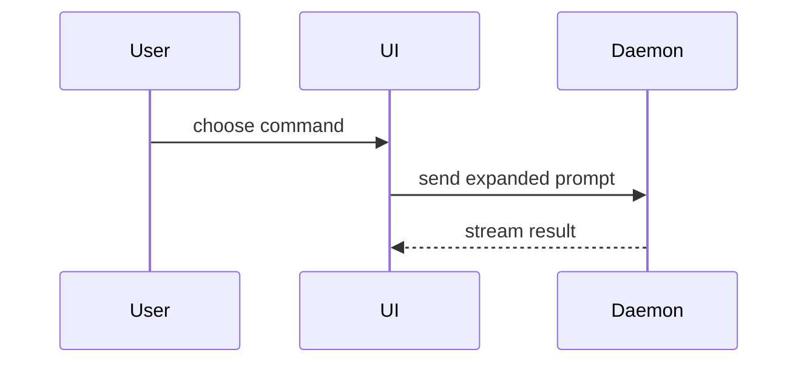

# PR Visuals

Forms for the Overview Visual and Overall Flow blocks. GitHub renders only fenced
markdown, so every visual is one fenced block (`text`, `diff`, `tsx`, `mermaid`).

- **Overview Visual** shows the static shape: file tree, component tree.
- **Overall Flow** shows the runtime flow: call tree, pseudocode, Mermaid sequence.
- Never draw the same view twice.

Pick the smallest form that makes the point. Keep only the calls, files, props,
states, and boundaries a reviewer needs to understand the change.

## Static Shape

File responsibility or a broad refactor as a shallow file tree:

```text
src/
├── commands/       # parses user actions
├── sessions/       # owns session state
└── transport/      # sends API requests
```

UI structure as a component tree, including state and module boundaries that matter:

```tsx
<SessionPage> (apps/example/src/routes/session.tsx)
  useSessionEvents()
  <SessionToolbar>
    <RunSkillButton> (packages/ui)
```

## Runtime Flow

Logic or an algorithm as pseudocode:

```text
on(save)
  if content is unchanged
    return cached result
  write new content
  return fresh result
```

Control flow as a call tree:

```text
submitForm
  createSession
    persistPrompt
    launchAgent
  navigateToSession
```

Component interaction or data flow with Mermaid:



## Diff Forms

Use `diff` when the point is what changes and the surrounding shape already exists.
Match the diff shape to the topic.

Component change:

```diff
 <SessionPage>
   useSessionEvents()
   <SessionToolbar>
+    <RunSkillButton />
   <SessionTimeline>
+    <SkillResultCard />
```

File-layout change:

```diff
 src/
 ├── commands/
+│   └── expand.ts        # expands the slash command
 ├── sessions/
-└── transport.ts
+└── transport/
+    ├── client.ts
+    └── stream.ts
```

Call-tree change:

```diff
 submitForm
   createSession
     persistPrompt
+    expandSkillMention
     launchAgent
-  navigateToSession
+  navigateToSession
+    subscribeToEvents
```

State or control-flow change:

```diff
 on(save)
-  write content
+  if content is unchanged
+    return cached result
+  write new content
+  invalidate cache
```
